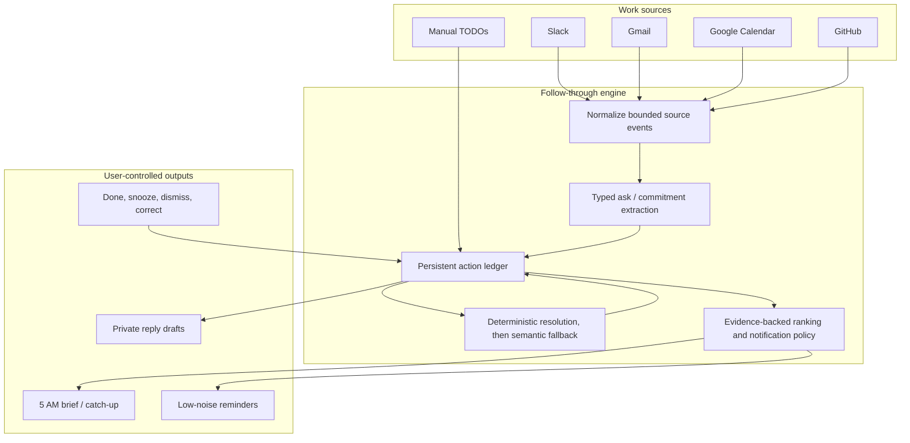
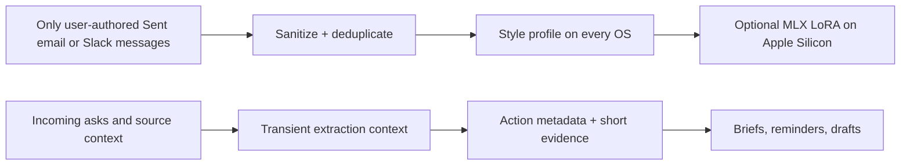
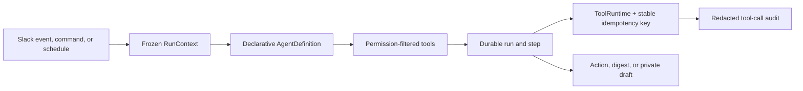
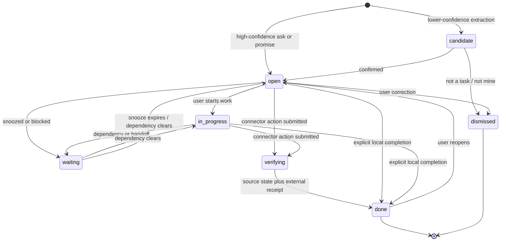

# Carmen Assistant

Carmen Assistant is a privacy-conscious personal work agent. It remembers what
people asked its user to do, what the user promised to do, and what still needs
a response. It can produce an evidence-backed morning brief, track work through
completion, remind the user about high-confidence follow-ups, and draft replies
in their own email or chat voice without sending them automatically.

The repository supports two complementary runtimes:

- **Cross-platform local runtime:** Python 3.11+ on macOS, Linux, or Windows,
  with Ollama or another OpenAI-compatible local server, terminal chat, local
  source snapshots, `TODO.md`, reply drafts, native scheduling, and desktop
  notifications.
- **Apple Silicon MLX extension:** optional MLX inference and local LoRA voice
  training. This acceleration/training path is the only Apple-specific part.
- **Hosted Slack runtime:** Slack OAuth, signed events, encrypted tokens,
  Postgres, background jobs, persistent actions, private Slack DMs, slash
  commands, reconciliation, and an explicitly configured inference provider.

The core product idea is **high-precision follow-through**, not a generic chat
bot or another stream of summaries.

The project is open source under the Apache License 2.0. Release artifacts are
built from an explicit public-file allowlist so personal source data and trained
adapters are not part of the downloadable project.

## Product specification

### User problem

Work is distributed across Slack threads, email, Calendar, GitHub, and personal
notes. Important asks and promises disappear into that activity. Conventional
summaries repeat what happened but do not reliably answer:

1. What did someone directly ask me to do?
2. What did I explicitly say I would do?
3. What is still open, waiting, or overdue?
4. What needs a response, and what would I actually say?
5. Why is the assistant showing me this item?

### Product outcome

At 5:00 AM in the user's timezone, the assistant refreshes connected sources and
delivers a short brief of open
asks and commitments. Every item has source evidence and a stable ID. The user
can inspect, snooze, complete, dismiss, or correct it. Drafts are private
suggestions. External sending remains a separate, explicit action.

### Market position and competitive landscape

Carmen is not positioned as a generic chatbot or a replacement for every work
tool. Its focused category is a **local-first personal open-loop manager**: it
discovers work across systems, explains the evidence, helps the owner act, and
keeps tracking the item until its source confirms resolution.

The first target user is a product or engineering leader whose commitments are
distributed across Slack, Gmail, Calendar, and GitHub. The core promise is:

> Open Carmen each morning and know what requires your attention, why it
> matters, and the safest next action.

The competitive set is fragmented:

| Product category | Representative products | Their strength | Carmen's intended distinction |
| --- | --- | --- | --- |
| Proactive executive assistant | [Lindy](https://www.lindy.ai/) | Broad integrations and proactive email/calendar workflows | Local ownership, inspectable evidence, deterministic lifecycle, and verified resolution |
| Automatic scheduling | [Motion](https://www.usemotion.com/help), [Reclaim](https://help.reclaim.ai/en/articles/14846468-reclaim-ai-2-0-overview) | Scheduling known tasks, habits, meetings, and focus time | Discover implicit work before deciding when to schedule it |
| Guided daily planning | [Sunsama](https://www.sunsama.com/features/daily-planning-and-shutdown), [Akiflow](https://akiflow.com/task-management) | Calm planning, timeboxing, and integrated task inboxes | Reduce manual task importing and reconstruct source context automatically |
| Structured team workflow | [Linear](https://linear.app/intake) | Team issues, triage, request intake, and agent delegation | Find personal work before anyone turns it into a formal issue; link to Linear rather than replace it |
| Email copilots | [Superhuman](https://help.superhuman.com/hc/en-us/articles/46005658551053-Auto-Reminders-Auto-Drafts), [Gemini](https://workspace.google.com/products/gmail/ai/), [Microsoft Copilot](https://support.microsoft.com/en-us/office/frequently-asked-questions-about-copilot-in-outlook-07420c70-099e-4552-8522-7d426712917b) | Native inbox prioritization, drafting, reminders, and scheduling | Combine email with Slack, Calendar, and GitHub in one personal attention model |
| Meeting memory | [Granola](https://www.granola.ai/) | Low-friction notes, meeting actions, and follow-ups | Reconcile meeting commitments with every other work source through completion |

The defensible asset is not the LoRA alone. It is the owner's correctable work
graph: recurring collaborators, implicit ownership, response habits, meeting
preferences, accepted and rejected recommendations, related records across
sources, and evidence that reliably means an item is finished. Style adaptation
improves drafting; the evidence and lifecycle system create trust.

Carmen should integrate with systems of record instead of replacing them. For
example, it may discover a Slack commitment, help with the immediate response,
and create or link a Linear issue only when the work requires a shared team
workflow.

Product usability is evaluated against five outcomes:

1. a connected user sees a real plan within ten minutes;
2. reviewed actionable-item recall is at least 90%;
3. fewer than 10% of surfaced tasks are irrelevant or already resolved;
4. the dashboard appears immediately from saved state while sources refresh
   independently;
5. the user can understand, act on, and verify a task without leaving the
   primary flow.

### Principles

- **Evidence before confidence.** An action must point back to a message,
  thread, event, PR, or email.
- **Precision over coverage.** An ambient FYI should not become a task. A direct
  ask or explicit promise should.
- **A state machine, not a daily summary.** Work persists until evidence or the
  user changes its status.
- **Low-noise reminders.** Only high-confidence direct asks or imminent
  deadlines may interrupt; uncertain items stay in the brief.
- **Private by default.** Local Ollama and MLX inference stay on the computer.
  Connector and hosted-provider boundaries are explicit and configurable.
- **Human-controlled writes.** Draft, inspect, and prepare automatically;
  sending or taking consequential action requires explicit approval.
- **Learn from corrections.** `not a task`, `not mine`, `already handled`,
  priority corrections, and draft outcomes are retained as structured feedback.

### Deliberate non-goals

- Autonomous Slack or email sending.
- Treating every mention, question, meeting, or notification as a TODO.
- Uploading the private LoRA training corpus to a hosted model provider.
- Using writing-style examples as factual context.
- Adding vector search or more model backends before action precision is good.

## Current capability map

| Capability | Local desktop | Hosted Slack |
| --- | --- | --- |
| Supported OS | macOS, Linux, Windows | Linux container |
| Chat in the user's voice | Ollama/OpenAI-compatible everywhere; MLX on Apple Silicon | Retrieved style examples + configured provider |
| Slack authored-message style corpus | Yes | Yes, authored-only |
| Incoming Slack ask extraction | Local snapshot triage | Event-driven, typed, evidence-backed |
| Explicit promise extraction | Local snapshot triage | Event-driven, typed, evidence-backed |
| Persistent lifecycle | Local TODO carryover | SQL action ledger + event history |
| Daily 5 AM brief | launchd, systemd, Windows Task Scheduler, or foreground scheduler | Timezone-aware scheduler + private DM |
| Reminders | macOS/Linux/Windows notifications with console fallback | Dedupe-protected urgent private DM policy |
| Resolution detection | Snapshot correlation + explicit completion | Slack thread reply/completion reconciliation |
| Reply drafting | Local configured model, saved locally | Private queued `/draft` DM |
| Feedback | Done/snooze | Action and draft feedback commands |
| Gmail / Calendar / GitHub | Local connector snapshots | Normalization/resolution contracts exist; direct hosted OAuth collectors are future work |
| External writes | Explicit action adapter | Drafts only; no automatic send |

## System architecture



Writing style and work truth are intentionally separate:



## Agent infrastructure

The product workflows share a small infrastructure layer instead of each
inventing its own authorization, prompt ordering, retries, and audit behavior.
The daily workflow remains deterministic; it is not forced into an autonomous
tool-calling loop merely to look agentic.



The shared abstractions live under `src/carmen_agent/infra/`:

- `RunContext` is immutable and fixes run ID, tenant, user, discriminated actor,
  surface, source thread, and permissions at dispatch.
- `AgentDefinition` keeps each hosted surface declarative. The framework-owned
  wrapper filters unavailable or unauthorized tools and sorts the resolved
  catalog before it is persisted.
- `ContextEngine` keeps a byte-stable system prefix first and appends session
  facts, recalled context, loaded instructions, transcript, and current input
  in that order. Hosted extraction/resolution/drafting and local triage/drafting
  use this shared assembly boundary.
- Every `Tool` must declare a class-level `ToolPolicy`. A missing policy fails
  when the class is defined, not during a production request.
- Policies declare user/tenant scope, read versus write, capabilities,
  required permissions, workload permissions, and approval requirements.
- The execution planner separates instruction loads, approval-gated calls,
  reads, and writes. The current bounded workflows execute serially; the plan
  makes safe read concurrency possible when a genuine multi-tool loop is added.
- `ToolRuntime` is the live execution object. It contains a stable framework
  idempotency key distinct from the model/tool correlation ID; network clients
  never cross the persistence boundary.
- One serializer handles tool output. Private tool inputs and outputs are stored
  as hashes by default; only explicitly snapshot-safe tools retain clear values.

### Durability and retry semantics

Hosted work persists `agent_runs`, `run_steps`, and `tool_calls`. A run records
its resolved surface version, model config, and sorted tool names. Each step and
write tool has a stable idempotency key.

- A worker crash leaves the job reclaimable after a ten-minute lease timeout.
- Tool calls and each reconciliation item refresh the lease while work is active.
- Ordinary failures retry up to three total attempts with the same run ID.
- Retryable jobs retain their payload; terminal jobs erase it.
- Completed durable steps are replayed from stored output.
- Completed write tools are not executed twice when a later part of the step
  fails. Read tools may safely run again.
- Draft IDs are derived from the run, so a retry updates one draft instead of
  creating duplicates.
- An urgent Slack DM is sent through the durable write boundary before its
  notification-delivery claim is finalized. This avoids both lost reminders
  and duplicate sends across crashes.

Slack history, thread reads, and permalink resolution are declared private-data
read tools. Posting a private assistant DM is a declared external write, but it
does not impersonate the user. The local action adapter is a separate
`approval="explicit"` write tool and cannot run without the user's `/do` or
shell command.

## Action model

### Lifecycle



Each `ActionItem` contains:

- stable action ID, tenant, and target user;
- source and source record ID;
- type: `reply`, `review`, `decision`, `deliverable`, `meeting_prep`, or
  `follow_up`;
- summary, requester, explicit-ask flag, confidence, and priority score;
- due date, channel/thread IDs, and permalink when available;
- lifecycle stage, snooze time, last check time, resolution mode, last verified
  time, and optional action-receipt ID.

The SQL ledger adds immutable evidence and transition history. The related
tables are `actions`, `action_evidence`, `action_events`, `action_feedback`,
`draft_feedback`, `source_cursors`, and `notification_deliveries`.

### Extraction rules

The model returns typed JSON. A conservative heuristic is the fallback if the
model is unavailable or returns invalid JSON.

- An incoming channel message needs a direct `<@user>` mention plus an ask.
- An incoming DM may qualify when it contains an ask.
- A message authored by the configured user qualifies only when it includes an explicit
  commitment such as “I'll,” “I can,” or “let me.”
- Ambient channel questions cannot be promoted by the model without assignment
  evidence.
- Deadlines are stored only when present; the model is instructed not to invent
  them.
- Confidence below `0.70` creates a `candidate`, which appears below confirmed
  work and cannot trigger an urgent interruption.

### Resolution and recovery

Slack events provide the fast path. An hourly reconciliation job provides the
recovery path if an event was missed or work changed later.

Deterministic rules run first:

- a user reply resolves a `reply` action as `responded`;
- “done,” “sent,” “shipped,” “merged,” and similar user-authored thread replies
  resolve appropriate work as `completed`;
- “waiting on,” “blocked by,” or “pending” moves work to `waiting`;
- explicit `/done`, `/handled`, and dismissal commands always win, but are
  recorded as local or dismissed resolutions rather than source verification.

Slack and Gmail searches are bounded, so a missing search result never closes
an existing open loop and tasks do not disappear through age-out. Every
previously tracked native record is explicitly re-read on later collections,
even outside the ordinary lookback window. It remains open until later source
evidence proves it answered, completed, cancelled, or superseded, or the user
dismisses it. GitHub and Calendar may additionally reconcile absence because
their collectors produce exhaustive open/future inventories.

Gmail, Calendar, and GitHub connector contracts also define deterministic
resolution signals such as sent replies, RSVP state, submitted reviews, merged
PRs, and closed issues. The local workflow uses normalized snapshots today;
hosted OAuth ingestion for these three sources is the next connector layer.

### Calendar personalization

Calendar behavior is learned as an inspectable private preference profile, not
as writing-style LoRA training. For each future actionable event, the collector
can inspect up to 90 days of the exact recurring series and return bounded counts
for accepted, declined, tentative, and unanswered invitations. Explicit
attendance/missed counts are used only when the connected source actually exposes
attendance records; an accepted RSVP is never treated as proof of attendance.

The user can also mark a Calendar task **Usually skip** or **Usually attend** in
the UI. Exact normalized meeting-title and optional organizer rules are stored in
`work/calendar-preferences.json`. Repeatedly skipped optional meetings are
down-ranked to FYI with a visible personalized rationale, while required
decisions, conflicts, and concrete preparation are protected from history-only
suppression. Explicit user feedback takes precedence over inferred response
patterns. Ordinary task completion does not teach a dismissal preference.

Reconciliation uses hourly cursor keys so scheduling is idempotent. Completed
job payloads are erased. Durable tool calls and notification delivery records
prevent repeated alerts for the same action/deadline.

## Cross-platform installation

The base agent supports macOS, Linux, and Windows. It requires Python 3.11+,
[`uv`](https://docs.astral.sh/uv/getting-started/installation/), and a model
server. Git is only required when cloning instead of downloading a release.
[`Ollama`](https://ollama.com/download) is the recommended local server for a
consistent setup across devices. MLX is an optional Apple Silicon extension,
not a base requirement.

### 1. Download or clone the source

For the simplest sendable installation, download
`carmen-personal-agent-<version>-source.zip` from the repository's Releases
page, verify the adjacent SHA-256 file, unzip it, and enter the folder:

```bash
shasum -a 256 -c carmen-personal-agent-0.1.0-source.zip.sha256
unzip carmen-personal-agent-0.1.0-source.zip
cd carmen-personal-agent-0.1.0
```

On Windows PowerShell, verify with:

```powershell
(Get-FileHash .\carmen-personal-agent-0.1.0-source.zip -Algorithm SHA256).Hash
```

Compare that value with the `.sha256` file before unzipping. Alternatively,
clone the repository:

```bash
git clone <repository-url>
cd carmen-personal-agent
```

Replace `<repository-url>` with the public Git URL after this project is
published. The release zip contains the application, tests, public examples,
documentation, and packaging metadata. It does not contain a model, personal
messages, connector credentials, generated TODOs, drafts, training datasets, or
LoRA adapters.

### 2. Install for your operating system

#### macOS

Install `uv`, install the Ollama app from the link above, open Ollama once, and
then run:

```bash
curl -LsSf https://astral.sh/uv/install.sh | sh
uv python install 3.12
uv sync
ollama pull qwen3:4b
uv run carmen init --name "Your Name" --provider ollama
uv run carmen doctor
uv run carmen ui
```

On an Apple Silicon Mac, MLX inference and private LoRA training are also
available:

```bash
uv sync --extra mlx --extra dev
uv run carmen init --name "Your Name" --provider mlx \
  --model mlx-community/Qwen3-4B-Instruct-2507-4bit
uv run carmen doctor
uv run carmen ui
```

The dashboard always uses the clean Qwen base model for planning. After the
optional UI fine-tune completes, it loads the adapter only for grounded message
drafts. MLX is not supported on Intel Macs, Linux, or Windows.

#### Linux

Install `uv` and Ollama, then run:

```bash
curl -LsSf https://astral.sh/uv/install.sh | sh
curl -fsSL https://ollama.com/install.sh | sh
uv python install 3.12
uv sync
ollama pull qwen3:4b
uv run carmen init --name "Your Name" --provider ollama
uv run carmen doctor
uv run carmen ui
```

Linux notifications use `notify-send` when it is available and fall back to
terminal output otherwise. Scheduled installation uses a per-user systemd
service.

#### Windows PowerShell

Install `uv` and the Ollama Windows app, open PowerShell in the cloned folder,
and run:

```powershell
winget install --id=astral-sh.uv -e
uv python install 3.12
uv sync
ollama pull qwen3:4b
uv run carmen init --name "Your Name" --provider ollama
uv run carmen doctor
uv run carmen ui
```

Windows uses PowerShell desktop notifications with a console fallback and
Windows Task Scheduler for its background schedule. The `.sh` convenience
scripts are for macOS/Linux; Windows users should use the equivalent `uv run`
commands shown above.

### 3. Verify the daily agent

Run these commands on every device after installation:

```bash
uv run carmen doctor
uv run carmen today --no-collect
```

`carmen doctor` reports the model backend, scheduler, notification backend,
data location, and optional collector availability. Opening `carmen ui`
automatically installs or repairs the saved local-time schedule using launchd
on macOS, systemd on Linux, or Windows Task Scheduler. If the computer missed
the selected time, opening the app later runs one catch-up refresh. The default is
5:00 AM with reminder checks every 30 minutes. In Settings → Daily automation,
users can choose a morning refresh time and a reminder cadence from safe presets,
save and repair the schedule, reinstall the saved schedule, or check reminders now.
The dashboard
Refresh runs the read-only connector collection and deterministic reconciliation
immediately. It does not wait for MLX model loading, drafting, or training, and each
source is time-bounded so the button always returns. Model-powered chat and explicit
daily synthesis remain separate operations.

The Slack/Gmail/Calendar/GitHub collector is optional. Direct mode uses the
provider credentials described below; compatibility mode needs a signed-in
Codex CLI with access to those connectors. Local chat and manual TODO commands
work without either collection path.

### 4. Personalize your own agent from the UI

Open **Settings → Your voice** and select **Personalize my agent**. This is the
normal onboarding path; a user does not need to prepare files or run a training
command.

The local app is single-owner by design: each operating-system user or installed
instance has its own identity, connector authorization, task state, voice
profile, and optional adapter. It does not train one shared “Carmen” model across
everyone who downloads the repository.

The button performs a bounded, user-owned pipeline:

1. resolve the authenticated Gmail and/or Slack user;
2. import up to 500 writing samples from Gmail Sent mail and recent Slack DMs,
   group DMs, and channels, keeping only content authored by that exact user;
3. reject other authors, quoted email history, signatures, forwarded blocks,
   bot/automated content, duplicates, link-only posts, common secrets, and
   malformed records;
4. remove URLs, emails, phone numbers, Slack identifiers, UUIDs, long IDs, and
   tokens locally;
5. activate a cross-platform voice profile for phrasing, casing, brevity, and
   only the custom emoji aliases actually observed;
6. on Apple Silicon, offer **Fine-tune locally** as an optional MLX LoRA step.

The Settings card shows imported/usable message counts, the active stage, the
connection path, and the next action. **Update from recent writing** safely
rebuilds the profile while preserving the last successful profile if collection
fails. If a matching adapter is already present after a transfer or earlier
training run, the UI offers **Activate existing fine-tune** instead of making the
user retrain it. The corpus, processed profile, and adapter are ignored by Git
and excluded from public release archives.

Direct Slack import uses `CARMEN_SLACK_USER_TOKEN` and communicates only with
Slack. If that token is absent, a source install can use authenticated Gmail
and/or Slack through the Codex compatibility bridge; that bridge is a separate
remote connector boundary and follows its installed connector controls. Profile construction, LoRA
training, and MLX/Ollama inference remain on the user's device. A configured
remote model endpoint is not local and receives the bounded prompt sent to it.

### Keeping the assistant consistent across devices

To make the assistant behave similarly on two computers:

1. Install the same release or Git commit on both devices.
2. Use the same provider and exact model tag, such as Ollama `qwen3:4b`.
3. Run `carmen init` with the same display name.
4. Copy `data/processed/style_profile.json` securely to the other device's
   data directory if both devices should share the same writing style.
5. Run `carmen doctor` on each device and compare the configuration before
   chatting.

Do not put the style profile, training messages, inbox snapshots, drafts, or
adapters in a public Git repository. They can contain private workplace data.
Use an encrypted private transfer or encrypted personal sync location.

An MLX LoRA adapter is specific to the MLX model path and is not directly
loadable by Ollama. For the closest cross-platform match today, use the same
Ollama model plus the same sanitized style profile on every device. Exact
token-for-token output is not guaranteed because runtimes and sampling can
differ by platform.

### Install the `carmen` command globally

The steps above run inside the source checkout. To call `carmen` from another
directory:

```bash
uv tool install .
carmen init --name "Your Name" --provider ollama
carmen doctor
carmen ui
```

Installed builds keep generated data out of the Python package:

| OS | Default data directory |
| --- | --- |
| macOS | `~/Library/Application Support/CarmenAgent` |
| Linux | `$XDG_DATA_HOME/carmen-agent` or `~/.local/share/carmen-agent` |
| Windows | `%LOCALAPPDATA%\CarmenAgent` |

Set `CARMEN_HOME` to override the data directory. A source checkout keeps its
state in the checkout for backward compatibility. `config.json` contains only
non-secret settings; API keys must remain in environment variables.

If you only want the command-line application, download the release wheel and
install it directly:

```bash
uv tool install ./carmen_personal_agent-0.1.0-py3-none-any.whl
carmen init --name "Your Name" --provider ollama
carmen ui
```

The wheel includes the local UI, collector schema, and hosted database
migrations. The full source zip is required for contributor tests, Docker files,
and the MLX training convenience script.

### Model backends

| Backend | Platforms | Setup |
| --- | --- | --- |
| Ollama | macOS, Linux, Windows | `carmen init --provider ollama`; defaults to local `qwen3:4b` |
| OpenAI-compatible | macOS, Linux, Windows | Set base URL, model, and `CARMEN_MODEL_API_KEY` for non-local endpoints |
| MLX | Apple Silicon macOS only | `uv sync --extra mlx`; `carmen init --provider mlx --model mlx-community/Qwen3-4B-Instruct-2507-4bit` |

The local Ollama endpoint does not require an API key. A remote endpoint
receives prompt content and therefore changes the privacy boundary.

`carmen` is a shell command. Inside terminal chat, use slash commands. Typing
`carmen-daily` into the model chat sends those words to Qwen; it does not launch
a shell process.

### Shell commands

| Command | Purpose |
| --- | --- |
| `uv run carmen init --name "Your Name"` | Initialize portable data and model configuration. |
| `uv run carmen doctor` | Check this computer before running the agent. |
| `uv run carmen ui` | Open the private local dashboard in your browser. |
| `uv run carmen chat` | Chat with the configured model and local style profile. |
| `uv run carmen today` | Refresh sources, triage work, and write the brief. |
| `uv run carmen collect` | Refresh Slack, Gmail, Calendar, and GitHub snapshots without loading Qwen. |
| `uv run carmen collect --sources slack` | Refresh only Slack when intentionally doing a partial collection. |
| `uv run carmen tasks` | List open local work. |
| `uv run carmen add "Prepare launch notes"` | Add a personal TODO. |
| `uv run carmen show 1` | Show the task and supporting context. |
| `uv run carmen draft 1` | Print its suggested response. |
| `uv run carmen remind 1 --at "2026-08-13 15:00"` | Set an exact reminder. |
| `uv run carmen snooze 1 --minutes 60` | Snooze it. |
| `uv run carmen done 1` | Mark it complete. |
| `uv run carmen do 1 --with-command /absolute/adapter` | Execute via an explicit authenticated adapter. |
| `uv run carmen schedule --install` | Repair the automatic 5 AM brief and reminders for the current OS. |
| `uv run carmen scheduler` | Run the portable scheduler in the foreground. |
| `uv run carmen eval` | Run frozen extraction-quality gates without live model access. |
| `uv run carmen-prepare` | Sanitize the writing corpus and make MLX datasets. |
| `./run-train.sh --iters 20` | Run a short LoRA smoke test. |
| `./run-train.sh` | Run the configured 600-iteration LoRA training. |

Compatibility aliases remain: `carmen-ui`, `carmen-chat`, `carmen-daily`, `carmen-do`,
`carmen-collect`, `carmen-remind`, and `carmen-schedule`.

## Local app interface

Start the local app from the project checkout:

```bash
uv run carmen ui
```

Or, after `uv tool install .`:

```bash
carmen ui
```

The command starts a server bound only to `127.0.0.1:8765` and opens the app in
the default browser. It is not hosted on the internet. Stop it by returning to
the launching terminal and pressing `Ctrl+C`.

Useful launch options:

```bash
carmen ui --no-browser
carmen ui --port 9000
carmen ui --provider ollama --model qwen3:4b
carmen ui --provider mlx --base-only
```

The interface is organized around trust and follow-through:

- a ranked Today plan with at most three **Focus now** items, followed by later
  work and suggestions that need review;
- three decision-oriented summary signals—**Do now**, **Need a response**, and
  **Meetings**—instead of a row of lifecycle counters;
- a compact source-health strip that keeps the latest automatic refresh and
  per-source state visible without occupying the task area when everything is healthy;
- filtered Messages, Meetings, Waiting, Review, and Completed views;
- a separate Review queue for low-confidence or historical imports, with
  **Add to my plan**, **Not a task**, **Not mine**, and **Already handled**
  corrections that feed the local dismissal history;
- task context and safe links back to Slack, Gmail, Calendar, or GitHub;
- an explanation for every recommendation, including confidence, source, and
  the last verification timestamp;
- one primary recommended action per task, such as drafting a reply, preparing
  a meeting, planning a follow-up, or creating a focused 30-minute work block;
- human-readable due dates such as **Due today**, **Due tomorrow**, and
  **2d overdue**; malformed historical dates are presented as correction prompts;
- existing reply drafts and a clipboard action;
- one prominent next action plus **Mark done**; editing, lifecycle, reminders,
  source verification, and original-source links are grouped under **More**;
- Calendar-specific **Usually skip** and **Usually attend** feedback that adjusts
  recurring-meeting priority and explains the personalization;
- one **Ask Carmen about this task** entry point for contextual drafting,
  planning, and source questions;
- a workspace-level freshness status that keeps stale connector tasks visible
  and counted without repeating a failure badge on every task card;
- a saved-snapshot fallback that can restore still-actionable cached items with
  prominent historical labels while deterministically excluding past calendar events;
- a **Refresh now** action in that banner that runs the fixed daily collection
  pipeline in the background, prevents overlapping runs, and reports its state;
- automatic installation or repair of a daily 5:00 AM local-time refresh, plus
  catch-up collection when the app opens after a missed run;
- visible chat provenance showing the provider, exact model, LoRA/base mode,
  selected task source, and whether its source message was loaded;
- a simplified default Settings view for connections and automation, with
  model internals, diagnostics, and LoRA controls grouped under Advanced;
- a global quick-action menu (`⌘K` or `Ctrl+K`) for task search, capture,
  refresh, review, chat, and settings;
- mobile task details presented as a dismissible bottom sheet instead of being
  appended beneath the entire list;
- responsive desktop and mobile layouts, visible keyboard focus, larger status
  text, and an installable PWA manifest.

### UI-first operation

After the application is opened, routine use does not require a terminal. The
dashboard covers:

- refreshing Slack, Gmail, Calendar, and GitHub and rebuilding the task list;
- listing, reviewing, correcting, inspecting, adding, editing, completing,
  snoozing, and reminding;
- drafting responses and chatting against verified task/source context;
- saving the user identity, model provider, exact model, endpoint, and optional
  action-adapter path;
- running device diagnostics;
- customizing, inspecting, or repairing the automatically managed daily brief and reminder schedule;
- checking and delivering due reminders immediately;
- preparing sanitized style data, running a 20-iteration training test, running
  the full 600-iteration MLX LoRA job, and executing frozen quality checks;
- explicitly executing one selected task through the configured adapter after
  an in-UI confirmation.

These controls call fixed, allowlisted application workflows. There is no
generic command field or shell endpoint. Background work exposes only bounded
status in the browser; detailed logs remain local to the app process. Installing
the package and opening it for the first time remain bootstrap steps until native
`.dmg`, `.msi`, and Linux packages replace the current local-browser launcher.

Ask Carmen uses the shared `ContextEngine`. General reasoning and planning run
on the clean Qwen base model with a restrained tone prompt; the narrow Slack
LoRA is not used as a reasoning engine. Source-backed drafting can use the
sanitized style profile for voice. Bounded selected-task data is marked as
untrusted reference context, followed by conversation history and the current
question. The LoRA training corpus is never factual memory. Answers pass a
response-quality guard; malformed control tokens, meaningless fragments, and
unexpected cross-script output are retried once at low temperature, then
replaced with a conservative grounded fallback.

For a selected task, the context engine now builds a bounded evidence bundle
instead of loading one arbitrary source message. Exact native source IDs,
explicit related keys, and exact links can join Slack, Gmail, Calendar, and
GitHub records without fuzzy title matching. Every bundle reports expected,
covered, and missing sources, its newest activity time, conflicting completion
states, and whether content was truncated. The model receives each record with
its source, native ID, timestamp, thread, status, and typed metadata, so its
answer remains attributable and the UI can explain what context was actually
loaded.

Open any active task and choose **Edit** to change its title, notes, priority,
due date, or reminder. Only fields that actually changed become explicit user
overrides. Those fields remain stable across later connector/model refreshes;
all other source-derived fields can continue updating. The original Slack,
Gmail, Calendar, or GitHub excerpt is immutable and remains visible separately.
Use **More** to access **Start working**, **Mark waiting**, editing, reminders,
and source verification. **Mark done** remains directly available as the common
completion action. These controls launch fixed application workflows, so normal
use does not require a terminal.

The local HTTP boundary has deliberate protections: it refuses non-loopback
bind addresses, validates the request host, requires an unpredictable
per-process token for every mutation or model request, emits no permissive CORS
headers, and applies a restrictive Content Security Policy. Dynamic source text
is inserted as text rather than executable HTML. Draft file reads are confined
to the configured private drafts directory.

### Input and output contracts

All external, persisted, and model boundaries are both shape-validated and
size-bounded. Validation fails closed before malformed data reaches a prompt or
overwrites task state.

| Boundary | Contract and bound |
| --- | --- |
| Connector result | `configs/collector-output.schema.json`; exact fields, four coverage records maximum, 2,000 records total and 500 accepted per source |
| Source snapshot | JSON array only; 5 MiB and 500 records per source; source must match filename |
| Source record | Stable non-empty ID; allowlisted source/status; 20,000-character body; bounded strings and arrays; HTTP(S) URLs only |
| Metadata | Allowlisted scalar fields only; JSON-safe and at most 32 KiB |
| TODO/state | Exact `TodoItem` fields and runtime types; 5 MiB and 1,000 tasks; confidence constrained to 0–1; lifecycle and resolution enums validated |
| Connector action | Allowlisted action ID and source pairing; explicit user confirmation; bounded adapter response and durable local receipt |
| Local HTTP request | 64 KiB body; unknown fields rejected; chat message 4,000 characters and history 12 messages × 4,000 characters |
| Triage model output | One JSON object, exact allowlisted keys, 8,192 characters maximum, strict booleans/numbers/enums |
| Draft/chat model output | 2,000/8,000 characters maximum; control tokens and unexpected scripts rejected; one retry then grounded fallback |
| Semantic resolution | Exact four-field JSON object, 4,096 characters maximum, typed confidence and source-owned evidence ID |

Python runtime validators live in `skills/schemas.py`; they deliberately do
not rely on dataclass type hints, because type hints alone do not validate JSON
at runtime. Corrupt state is reported and left untouched rather than silently
treated as an empty task list.

This is the cross-platform application layer planned for the eventual Tauri
shell. Keeping the UI and Python service separate means the same interface can
later be packaged as `.dmg`, `.msi`, and Linux desktop installers without
rewriting the task or model engine. The current version opens in the browser;
native Tauri packaging and tray behavior remain a distribution increment.

### Terminal-chat commands

| Command | Purpose |
| --- | --- |
| `/tasks` | List open tasks. |
| `/add <task>` | Add a task. |
| `/show <id>` | Show context. |
| `/draft <id>` | Show the local draft. |
| `/remind <id> <time>` | Set an exact reminder. |
| `/snooze <id> <minutes>` | Snooze it. |
| `/do <id>` | Use the configured action adapter. |
| `/done <id>` | Complete it. |
| `/daily` | Print the shell command that runs the daily agent. |
| `/reset`, `/help`, `/quit` | Manage the chat session. |

## Local daily workflow

```bash
uv run carmen today
uv run carmen today --collect-sources slack
uv run carmen today --no-collect
```

By default, `carmen today` refreshes all four connected sources: Slack, Gmail,
Calendar, and GitHub. In `auto` mode, Carmen uses a first-party provider API
adapter for each source that has direct credentials and falls back source by
source to the authenticated Codex connector bridge for anything not yet directly
authorized. Direct reads do not send source content to an inference model. The
compatibility bridge crosses the Codex connector service boundary. Triage,
drafting, TODO state, chat, and local inference remain separate from collection.

Direct adapters can be configured through environment variables until UI OAuth
is complete:

```bash
export CARMEN_CONNECTOR_MODE=auto
export CARMEN_SLACK_USER_TOKEN="..."
export CARMEN_GOOGLE_CLIENT_ID="..."
export CARMEN_GOOGLE_CLIENT_SECRET="..."
export CARMEN_GOOGLE_REFRESH_TOKEN="..."
export CARMEN_GITHUB_TOKEN="..."
export CARMEN_GITHUB_USERNAME="your-login"
```

Use least-privilege read scopes and keep these values in the shell environment
or operating-system credential store. An untracked `.env` must be explicitly
sourced; Carmen does not silently load it. `CARMEN_CONNECTOR_MODE=direct` disables
the bridge and fails unconfigured sources immediately;
`CARMEN_CONNECTOR_MODE=codex` explicitly selects the compatibility bridge. Use a
local Ollama/MLX endpoint and direct or independently supplied snapshots if no
work content may cross an inference-service boundary.

Every result remains isolated per source, with explicit `ok`, `empty`,
`unavailable`, or `error` coverage. A successful source replaces only its own
snapshot atomically. A failed source keeps its last good snapshot and makes the
overall refresh visibly degraded, so the dashboard never presents a partial
refresh as fully current. Direct adapters read independently in parallel and
serialize only their local snapshot/status commits, so a slow Slack read cannot
prevent Calendar changes from reaching the dashboard. The compatibility bridge
uses separately bounded progressive sessions to avoid local runtime contention.
The **Settings → Connections** panel shows live per-source progress, the last
success, direct-versus-bridge transport, read duration, and failure reason.

Connector collection explicitly overrides the interactive Codex reasoning
setting to `low`. Collection is a bounded read-and-normalize operation with a
strict output schema, so inheriting a personal `high` or `xhigh` reasoning
setting adds latency without replacing Carmen's deterministic validation. This
setting affects collection only; it does not change the local Qwen/MLX chat
model or LoRA training.

The current direct readers are pull-based. Webhook/Pub/Sub invalidation,
subscription renewal, and provider incremental pagination are the next real-time
increment. See [`docs/SYNC_ARCHITECTURE.md`](docs/SYNC_ARCHITECTURE.md).

Connected accounts must be authenticated once. After that, Carmen attempts every
configured source independently on the automatic 5:00 AM run and whenever the
user clicks **Refresh all**. It does not suppress a source merely because a stale
local plugin catalog omits it. No terminal command is required for normal operation.

Every collection attempt records per-source coverage, success time, error
detail, item count, transport, and latency in `data/inbox/_source-status.json`.
Coverage receipts
state the searched surfaces and window plus candidate/expansion counts, making
an empty result distinguishable from a shallow or unavailable search. Snapshots older than
48 hours are excluded from triage by default; override that bounded policy with
`--source-max-age-hours` or `CARMEN_SOURCE_MAX_AGE_HOURS`. A failed refresh may
leave the old JSON file on disk for recovery, but it cannot refresh that
source's tasks or `last_seen` timestamps.

Freshness is also tracked at the task level. A successful Slack or Gmail run
does not make an unseen carried task current: the exact native ID must be
re-observed in that run. If it is not, the task remains counted and visible but
is labeled stale until its targeted reconciliation succeeds.

When older actionable snapshots exist but cannot be verified as current, the
dashboard offers **Import saved tasks**. Imported tasks are deduplicated by
their native source IDs and remain visibly labeled as saved snapshots until
their connector refreshes; importing never represents historical work as
current.

Calendar events expire deterministically when their start time has passed
(unless they are represented as an explicit follow-up). Source actions with an
explicit expiry or later resolution evidence are also closed before local-model
triage. GitHub records marked closed or merged close matching tasks
deterministically. The collector includes every open authored PR plus recent,
explicit, still-pending review requests and recently updated issues assigned to
the user; mere mentions, comments, stale requests, and team review requests are
excluded. It also rechecks every previously tracked open loop outside the
ordinary lookback window. Absence from a fresh authoritative GitHub or Calendar
snapshot can reconcile prior work as complete; absence from bounded Slack or
Gmail searches cannot. Manual, Slack, and Gmail tasks never age out automatically.

Outputs are deliberately outside Git:

- `TODO.md` — the current morning brief;
- `data/inbox/*.json` — normalized source snapshots and structured TODOs;
- `data/inbox/_source-status.json` — per-source freshness and coverage metadata;
- `data/events/source-events.jsonl` — bounded append-only sparse source history;
- `data/drafts/` — local reply suggestions;
- `work/daily-chief-of-staff-state.json` — metadata carryover state;
- `work/source-cursors.json` — source-specific incremental cursors;
- `work/quality-telemetry.jsonl` — aggregate-only latency and quality metrics;
- `work/action-receipts.json` — bounded receipts for explicit connector actions;
- `work/calendar-preferences.json` — inspectable recurring-meeting preferences;
- `work/*.log` — scheduled-run logs.

An empty `TODO.md` means there are no source-derived or carried open loops. The
terminal prints a warning for missing, stale, or degraded sources, and the
local UI repeats that warning prominently. Stale and cached tasks remain
visible and included in totals, with freshness labels; staleness never silently
turns an open loop into completed work.

### External action boundary

The daily run never sends a reply. In the UI, Carmen offers only typed actions
compatible with the selected source—for example `slack.send_reply`,
`gmail.send_reply`, `calendar.accept`, `github.submit_review`, or
`github.merge`. After explicit confirmation, Carmen passes a versioned JSON
request to the configured, user-supplied authenticated adapter through stdin.
The adapter returns a bounded result such as:

```json
{"status": "submitted", "message": "Slack reply sent", "external_id": "171234.5678"}
```

`submitted`, `pending`, and even `completed` keep a typed connector task in the
`verifying` stage. Only `status: verified` together with a non-empty external
ID closes it as `source_verified`; the next source refresh can also provide the
deterministic completion evidence. Every attempt writes a receipt. The legacy
terminal `/do` path remains compatible and records a successful generic action
as a local completion. Credentials belong in the adapter, not in Qwen prompts,
LoRA data, or task files. The repository defines this safe adapter boundary but
does not ship third-party OAuth credentials or automatically send on a user's
behalf.

## Optional voice fine-tuning with MLX LoRA

This section requires an Apple Silicon Mac. It is an optional enhancement, not
a requirement for installing or running the agent on other computers. All
platforms can still build a sanitized style profile and use it in the system
prompt; only the MLX adapter training and adapter inference are Apple-specific.

The base model is `mlx-community/Qwen3-4B-Instruct-2507-4bit`. The configuration
is in `configs/lora.yaml`:

- 600 optimizer iterations;
- batch size 1 with four-step gradient accumulation;
- 16 adapted layers;
- attention `q`, `k`, `v`, and output projections;
- rank 8, scale 16, dropout 0.05;
- prompt masking, evaluation every 50 steps, checkpoint every 100.

**LoRA is fine-tuning.** Instead of modifying every Qwen weight, it trains small
low-rank adapter matrices and keeps the base model frozen. The result is much
smaller and more practical on Apple Silicon. Other common methods are full
fine-tuning (all weights), partial/layer fine-tuning, prompt or prefix tuning,
and preference tuning such as DPO after supervised examples. LoRA is the right
initial tradeoff here because the goal is voice adaptation with limited private
data and local compute.

The recommended path is **Settings → Your voice → Personalize my agent**, then
**Fine-tune locally**. The app imports authored writing, sanitizes it, runs the
packaged MLX job in the background, activates the resulting adapter, and resets
the draft session. The adapter is intentionally used only for message drafting;
general work planning and task reasoning continue on the base instruction model.

The commands below are developer/debugging equivalents for inspecting an
already imported corpus:

```bash
uv sync --extra mlx --extra dev
uv run carmen-prepare
./run-train.sh --iters 20
./run-train.sh
```

Preparation removes URLs, email addresses, phone numbers, Slack IDs, UUIDs,
long identifiers, duplicates, link-only messages, and common secret patterns.
Only the configured user's authored messages or sent-email bodies become
examples. Email and chat are labeled as distinct writing registers so the model
can preserve professional email conventions without making chat artificially
formal. The pipeline preserves observed Slack emoji aliases, records an
allowlist in the style profile, and tells the model never to invent an alias.

Training is **not scheduled daily**. Retrain after a meaningful reviewed batch
of representative new writing or when evaluation shows a real style gap. A
reasonable cadence is monthly or after several hundred useful messages, not
after every collection. Compare held-out output before replacing the current
adapter; more iterations are not automatically better.

Local preparation, training, and MLX inference do not send the corpus to Qwen's
creator or train a shared foundation model. Qwen base weights are loaded from
the local cache. The scripts fail closed on network access unless the one-time
bootstrap is explicitly allowed:

```bash
CARMEN_ALLOW_NETWORK=1 ./run-train.sh --iters 1
```

The adapter is still sensitive: fine-tuned models can memorize examples.

## Hosted Slack runtime

The hosted runtime is Linux-compatible and does not import MLX. It uses OAuth
v2, verifies every Slack signature, encrypts tokens at rest, queues model work,
and sends results only in private DMs.

### Slack commands

| Command | Purpose |
| --- | --- |
| `/catchup` | Send the current evidence-backed action list privately. |
| `/why <action-id>` | Show the reason, evidence excerpt, and source link. |
| `/done <action-id>` | Complete an action. |
| `/snooze <action-id> [minutes]` | Move it to waiting and suppress ranking temporarily. |
| `/handled <action-id>` | Mark it already responded/handled. |
| `/not-a-task <action-id>` | Dismiss a false positive. |
| `/not-mine <action-id>` | Dismiss incorrect assignment. |
| `/wrong-priority <action-id>` | Record ranking feedback without closing it. |
| `/confirm <action-id>` | Promote a lower-confidence candidate to open work. |
| `/draft <instruction>` | Generate a private reply suggestion. |
| `/draft-feedback <id> accepted\|modified\|rejected [edited text]` | Record draft quality feedback. |

Drafts are never posted into the source channel. Each private draft includes a
stable draft ID so its outcome can be measured.

### Services

| Service | Config | Command | Purpose |
| --- | --- | --- | --- |
| Web | `railway.toml` | Gunicorn | OAuth, signed events, commands, health check |
| Worker | `deploy/railway-worker.toml` | `carmen-hosted worker` | Extraction, drafting, digest, reconciliation jobs |
| Daily scheduler | `deploy/railway-daily.toml` | `carmen-hosted enqueue-daily` | Hourly timezone check; one brief/user/date |
| Recovery scheduler | `deploy/railway-reconcile.toml` | `carmen-hosted enqueue-reconcile` | Hourly idempotent source re-check |

Postgres migrations run before each Railway deployment. The web process returns
quickly to Slack and leaves model work to the worker.

### Hosted setup

1. Copy `configs/slack-app-manifest.yaml`, replace `YOUR_DOMAIN`, and import it
   into a Slack app.
2. Copy `.env.example` into a secret manager; never commit real values.
3. Generate a Fernet key and provide the same key to the web and worker.
4. Choose an OpenAI-compatible inference endpoint with an acceptable retention
   and training policy, or a self-hosted compatible endpoint.
5. Attach Postgres and deploy the four service configurations above.
6. Visit `https://YOUR_DOMAIN/slack/install` and authorize a test workspace.

Local hosted smoke test:

```bash
uv sync --extra hosted --extra dev
export DATABASE_URL=sqlite:///work/hosted-dev.db
uv run carmen-hosted serve --port 8080
uv run carmen-hosted worker
uv run carmen-hosted enqueue-daily
uv run carmen-hosted enqueue-reconcile
```

Required hosted variables are documented in `.env.example`. The model provider
interface is `src/carmen_agent/providers/base.py`.

## Privacy and security boundaries

| Stage | Location | Data that can leave the computer |
| --- | --- | --- |
| Corpus preparation | Local Python | Nothing |
| Optional LoRA training | Local MLX on Apple Silicon | Nothing |
| Terminal chat | Local MLX/Ollama | Nothing when the endpoint is local |
| Local triage/drafting | Configured model backend | Nothing when the endpoint is local and snapshots already exist |
| Default connected-source collection | Codex connector service | Bounded source content requested for collection |
| Hosted Slack extraction/drafting | Hosted worker + chosen inference provider | Transient message/thread context and selected style examples |
| Hosted persistent storage | Operator's Postgres | Encrypted OAuth tokens, authored style messages, action metadata, short evidence excerpts |

Hosted privacy invariants:

- Only connected users' own messages enter the writing-style corpus.
- Coworker messages may enter a short-lived extraction job and the configured
  inference prompt. They are persisted only when an actionable item is found,
  and then only as bounded evidence plus IDs/permalink.
- Completed job payloads are overwritten with `{}`.
- OAuth states are hashed, expire after ten minutes, and are one-time use.
- Slack request signatures are HMAC-verified with replay-window checks.
- OAuth tokens are encrypted with `CARMEN_TOKEN_ENCRYPTION_KEY`.
- Tenant and user IDs scope all action reads and commands.
- Source credentials are never added to model prompts.
- `.gitignore` and `.dockerignore` exclude corpora, adapters, snapshots, drafts,
  databases, environment files, and work logs.

Cloud inference is not fine-tuning, but it is still disclosure to the chosen
provider. For the strongest privacy boundary, keep MLX local or point the
hosted provider interface at infrastructure you control.

## Repository layout

```text
configs/lora.yaml                 MLX LoRA configuration
configs/slack-app-manifest.yaml   Slack OAuth, scopes, events, and commands
migrations/                       Postgres schema migrations
deploy/                           Worker and scheduler service configs
src/carmen_agent/actions/         Extraction/ranking plus typed connector actions and receipts
src/carmen_agent/apps/            Product-domain policy and bounded application schemas
src/carmen_agent/connectors/      Normalization/resolution contracts by source
src/carmen_agent/connectors/direct/ First-party provider API readers
src/carmen_agent/context/         Query routing, hybrid retrieval, bounded packets
src/carmen_agent/domain/          Sparse immutable source observations
src/carmen_agent/hosted/          OAuth web app, encrypted storage, queue, worker
src/carmen_agent/infra/           Run identity, definitions, context, tool policy, durability
src/carmen_agent/ingestion/       Independent sync orchestration and cursors
src/carmen_agent/evals/           Snapshot capture/replay, cases, grading, CLI
src/carmen_agent/observability/   Aggregate-only quality and latency telemetry
src/carmen_agent/projections/     Deterministic source/task read models
src/carmen_agent/providers/       MLX, Ollama, and OpenAI-compatible provider boundary
src/carmen_agent/ranking/         Personalized, inspectable task scoring
src/carmen_agent/skills/          Local triage, synthesis, drafting, TODO rendering
src/carmen_agent/storage/         Bounded append-only event storage
src/carmen_agent/assistant.py     Unified `carmen` CLI
src/carmen_agent/chat.py          Local terminal chat
src/carmen_agent/collector.py     Read-only source snapshot bridge
src/carmen_agent/prepare.py       Corpus sanitation and style profiling
src/carmen_agent/commands.py      Local task inspection and action boundary
src/carmen_agent/reminders.py     Local reminder policy and notifications
src/carmen_agent/scheduler.py     Platform-neutral daily/reminder scheduler
scripts/build-release-archive.py  Allowlisted, privacy-checked source exporter
scripts/verify-release.py         Archive structure and hash verifier
tests/                            Unit and workflow tests
evals/cases/                      Privacy-safe committed regression datasets
```

See [`docs/ARCHITECTURE.md`](docs/ARCHITECTURE.md) for dependency direction,
domain-package conventions, side-effect rules, and the staged refactoring map.

Private/generated directories such as `data/`, `adapters/`, `work/`, and
`TODO.md` are not source code and should remain untracked.

## Verification and product quality gates

```bash
uv sync --extra dev
uv run pytest -q
uv run carmen eval
python scripts/build-release-archive.py --check-only
```

The suite covers direct and compatibility collection, sparse event validation,
event idempotency/replay, independent health, bounded hybrid retrieval,
personalized ranking, aggregate telemetry, privacy sanitation, task synthesis, command
handling, reminders, Slack signature verification, OAuth state replay,
authored-only style storage, action extraction, evidence persistence, state
transitions, resolution, ranking, daily idempotency, and reconciliation cursors.
It also exercises Windows command parsing and scheduler generation, Linux
systemd generation, local OpenAI-compatible inference, and platform-neutral
scheduler behavior. CI on native macOS, Linux, and Windows is still recommended
before the first public release; simulated unit tests cannot catch every OS
service-manager or notification difference.

Every push and pull request runs the frozen accuracy gate on macOS, Linux, and
Windows. `carmen eval` runs the same privacy-safe extraction dataset and fails when
precision drops below `0.90` or recall below `0.75`. The world-snapshot layer
can record exact model inputs/outputs and replay them with live fallback
disabled, so prompt/model comparisons are not confused with changing source
data. Real production snapshots can contain private work context and belong in
ignored `evals/snapshots/`, never in Git. Ground truth should come from explicit
user feedback rather than copying the model's original output.

At runtime, connector and chat paths append aggregate-only duration, fallback,
token-budget, and item-count metrics to `work/quality-telemetry.jsonl`. The
telemetry schema rejects nested objects, source content, and record identifiers.
The UI overview exposes summaries so latency regressions and fallback rates can
be monitored without retaining message text.

Before production use, measure on a reviewed set of real messages:

- precision of direct-ask and commitment extraction;
- false reminders per user per week;
- percentage of brief items with useful evidence;
- time from source resolution to action closure;
- draft accept/modify/reject rate and edit distance;
- rate of `not a task`, `not mine`, and `wrong priority` feedback.

The release gate should favor low false-positive rates over maximum recall.

## Remaining roadmap

The core Slack follow-through loop is implemented. The next product increments
are:

1. UI OAuth and encrypted credential storage for the existing direct readers;
2. Calendar/Gmail watch renewal and GitHub/Slack webhook ingestion;
3. connector-specific pagination, retry/backoff, and incremental cursor fixtures;
4. bounded historical backfill with explicit date/source controls;
5. reviewed private recall and draft-acceptance evaluation datasets;
6. optional self-hosted inference profiles and encryption-key rotation tooling;
7. richer approval adapters for sending a selected draft or updating a source.

## Open-source releases

The code is licensed under the [Apache License 2.0](LICENSE), which permits use,
modification, and redistribution while preserving its license and notices.
Contributions follow [CONTRIBUTING.md](CONTRIBUTING.md), and vulnerabilities
follow [SECURITY.md](SECURITY.md).

Maintainers can create a sendable, deterministic source archive with:

```bash
python scripts/build-release-archive.py
python scripts/verify-release.py dist/carmen-personal-agent-0.1.0-source.zip
```

The builder includes only named public files and rejects common secret formats,
private keys, absolute workstation paths, and symlinks. The archive contains a
hash manifest; its own `.sha256` checksum is generated alongside it. Normal
Python wheels and source distributions are built with
`uv run --with build python -m build`. A matching `v<version>` tag triggers the
release workflow to test, build, verify, and attach all artifacts to GitHub.
See [docs/RELEASING.md](docs/RELEASING.md) for the first-public-push checklist.

The current workspace is not itself proof that prior Git history is clean.
Before the first public push, initialize a fresh repository from the sanitized
archive or separately audit every historical commit. Never publish ignored local
data merely because the current working tree looks clean.
